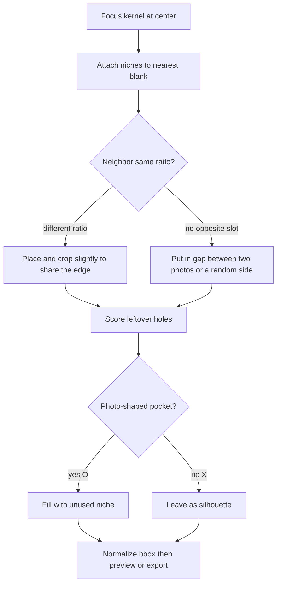

# Boundless Mode

New layout only. Do not rewrite Top / Bottom / Ring / Center, and do not edit [`.cursor/plans/gutter_split_drag_4ad96446.plan.md`](.cursor/plans/gutter_split_drag_4ad96446.plan.md). No browser/UI checks, no typecheck, no `npm run build`.

## What the layout does

The page is no longer a hard aspect rectangle. Photos grow as a collage on a whiteboard; export is the bounding box of those frames with a transparent background.

Aspect stays in the toolbar. In Boundless it is **guidance, not a clip**. `9:16` means prefer growing more vertically; `16:9` more horizontally; `1:1` keep the cluster roughly even. The collage may overshoot that ratio — there is no bounding box that photos must stay inside.

Focus group (your n=5 example): each focus cell targets **4:3 if landscape, 3:4 if portrait**, only if that aspect is inside `legalAspectRange` / `FOCUS_MAX_CROP`. Otherwise keep the photo’s preferred legal aspect. Cluster is compact and **centered** — later niches should not pile on one side.

Niches stay smaller (`FOCUS_MIN_RATIO` 1.5). With Include-all off, leave some unused as fillings (your “4 at the bottom right”). With Include-all on, every photo is placed; leftover photos after the attach pass still go through pocket fill, then relaxed attach.

## Packing (new path only)

Add `packBoundless` in [`src/packer.ts`](src/packer.ts) and branch in `pack()` **before** `coverPage`. Boundless must skip `coverPage` — that function fills a page rectangle and would flatten the collage.

**1. Focus kernel.** Size each focus photo around a unit short-side (scale from `PAGE_WIDTH`). Place the first at the origin; attach the rest with the same neighbor rules as niches, then translate so the **focus centroid stays at the origin**.

**2. Attach niches (anti-grid).** For each remaining niche, build candidate slots on the four sides of existing cells:

- Prefer the **closest blank** that shares an edge.
- Prefer a neighbor whose orientation is **not** the same as this photo (landscape beside portrait). Same-ratio neighbors recreate the old grid.
- Prefer slots that keep the focus centroid visually central (fill the lighter side of the cluster).
- **Aspect hint:** rank slots so the running bbox tends toward the selected aspect (`page.width / page.height`) without ever clipping to it. If the cluster is already too wide for a `9:16` hint, prefer up/down; if too tall for `16:9`, prefer left/right. Never reject a slot only because it leaves the hint ratio.
- Crop within `NICHE_MAX_CROP` so the new cell can share that edge cleanly (the “crop a bit to fit” in your last sample).
- If no opposite-ratio side exists: sit in the **corridor between two photos**, else a random outer side.

**3. Photo-shaped pocket fill.** After attach, take holes from `leftoverHoles` on the cluster bbox (not a 16:9 page). A hole is fillable (**O**) only if it looks like a real photo:

- aspect roughly in `[0.45, 2.2]`
- min side comparable to nearby niches (not a gutter sliver)
- enclosed on at least two sides by existing photos

Perimeter notches and L-steps (**X**) stay empty. Auto-fill O holes from unused niches; the existing `+` button should use the same filter via `spareHoles`.

**4. Normalize.** Shift so `x,y >= 0`. Return placements only; page size is the bbox.

## Preview: whiteboard, aspect is a hint

[`src/types.ts`](src/types.ts): `LayoutMode` includes `'boundless'`. [`src/App.tsx`](src/App.tsx): add Boundless to `LAYOUTS`. **Keep the Aspect control.** Changing preset still packs again — it only steers growth, it does not resize a page frame.

Pass the current `page` (from the aspect preset) into `packBoundless` as the hint ratio `page.width / page.height`. **Display page** is still the placement bbox + gutter, not the aspect rectangle. The 9:16 / 16:9 plate does not appear.

[`src/PagePreview.tsx`](src/PagePreview.tsx) + [`src/App.css`](src/App.css):

- `.page` keeps `--pw/--ph` from the bbox so cells still position with percentages, but Boundless drops the dark aspect plate (`background: transparent`). The visible frame is the collage itself, any ratio.
- Stage stays the dotted whiteboard; the cluster scales to fit like today (`min(100cqw, 100cqh * pw/ph)`), at the collage’s own ratio.
- Gap `+` only on O-shaped holes. Gutter split, pan, zoom, swap stay as they are.

## Export: tight frame, transparent PNG

[`src/exportPage.ts`](src/exportPage.ts) gains a boundless path (flag from App when `layout === 'boundless'`):

- Canvas size from **placement bbox**, not the aspect preset. Aspect never pads or crops the export.
- `alpha: true`, no `#0b0c0f` fill.
- Draw photos in bbox-relative coordinates (subtract min x/y).
- Other layouts keep the current opaque page export.

Original / long-edge sizes still apply to the bbox’s long edge.

## Files

- [`src/types.ts`](src/types.ts) — `'boundless'`
- [`src/packer.ts`](src/packer.ts) — `packBoundless`, pocket filter, skip `coverPage`
- [`src/App.tsx`](src/App.tsx) — layout option, keep Aspect as hint, bbox preview page, export flag
- [`src/PagePreview.tsx`](src/PagePreview.tsx) — boundless class; `spareHoles` already used
- [`src/App.css`](src/App.css) — whiteboard page
- [`src/exportPage.ts`](src/exportPage.ts) — tight transparent export
