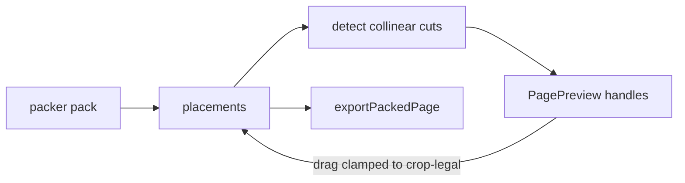

# Draggable gutter splits

Gutter gaps on the page are empty space between packed cells, not drawn lines. Hovering that dark strip should show a split handle. Dragging it moves the shared border: one photo grows, the neighbor shrinks, and the gap stays equal to the toolbar **Gutter**.

This is a **post-pack nudge**, not a packer rewrite. Export already draws whatever is in `placements`, so it follows for free.

## What dragging does

- **Vertical cut:** left cells change `w`; right cells change `x` and `w`. Gap stays `gutter`.
- **Horizontal cut:** top cells change `h`; bottom cells change `y` and `h`.
- Recrop each moved cell with existing `sourceRectForAspect` so focus still caps at 10% crop and niche at 25%.
- If the new cell aspect is illegal, **clamp the drag** (do not shrink the cell inside the box — that would leave a hole). `legalBox` in [src/packer.ts](src/packer.ts) is the wrong tool here.
- Do **not** re-enforce the packer’s 1.5× focus-vs-niche area rule while nudging. That would block the small personalization this is for.

## Which lines are draggable

Build cuts from the current `placements` + `gutter`:

- Two cells share a **vertical** seam when `left.x + left.w + gutter ≈ right.x` and their Y ranges overlap.
- Same idea for **horizontal** seams.
- Merge collinear overlapping segments into one cut so a T-junction (one tall cell vs two stacked neighbors) moves as a **single through-line**, not a jog that opens a hole.
- Skip messy L-shaped adjacencies: if moving the edge would overlap a non-participant or open a gap, that strip gets no handle.

Gutter `0` still gets an ~8px screen hit sliver on the shared edge.

## What we will not do (v1)

- No packer / worker / layout-mode changes.
- No local gutter thickness (you picked splitter).
- No saving nudges in localStorage. The existing pack effect in [src/App.tsx](src/App.tsx) already replaces `placements` when photos, aspect, layout, gutter, include-all, shuffle, or crop-safe change — that is the reset.
- Handles hidden during star/delete modes so those clicks stay simple.

## Files

- **New** [src/seams.ts](src/seams.ts): `findCuts(placements, gutter)`, `nudgeCut(placements, photos, cut, delta, gutter)` using `legalAspectRange` + `sourceRectForAspect` from [src/crop.ts](src/crop.ts). Keep a small min cell size (~24 page units).
- **[src/PagePreview.tsx](src/PagePreview.tsx):** overlay hit strips on each cut (not on `.placed` buttons). Hover shows a 1px line; `col-resize` / `row-resize`. Pointer capture; map client → page coords from the `.page` rect. Call `onPlacements` on move. Ignore when `modifying` / `starring`.
- **[src/App.css](src/App.css):** `.gutter-cut` hit area and hover/active line on the page background (`#0b0c0f`).
- **[src/App.tsx](src/App.tsx):** pass `gutter` and `onPlacements={setPlacements}`. Packing still owns the source of truth; a drag only edits the current result.

## Interaction details

- Pointer down on a cut must not select the photo underneath (`stopPropagation`, handle sits above cells in z-order but only in the gap).
- Tiny movement vs click: if the pointer barely moved, treat as no-op.
- While `packing` is true, ignore drags so a late worker result cannot overwrite a mid-drag.

## Verify

With the running app: 16:9 Center, a few photos, hover a vertical and a horizontal gap, drag slightly, confirm neighbors resize, gap width unchanged, crops still framed, export matches the preview. Change Layout or Gutter and confirm nudges reset. Star/delete still click photos, not splits.
